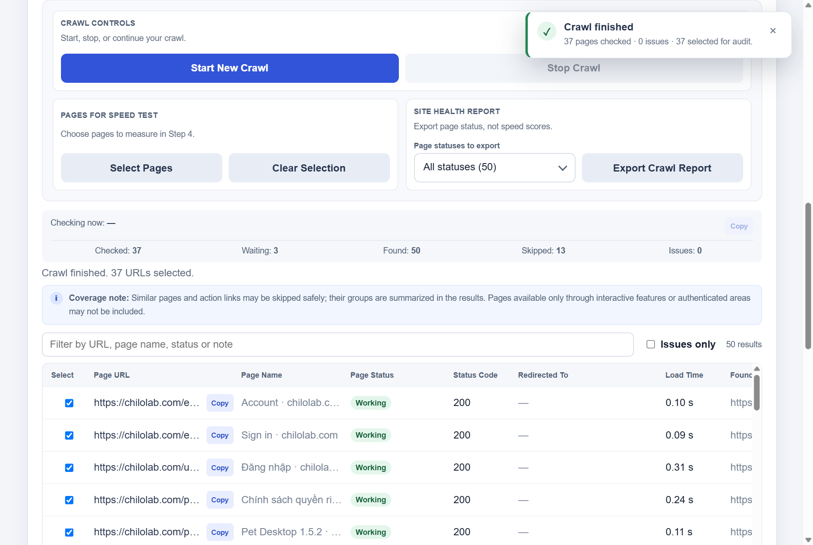
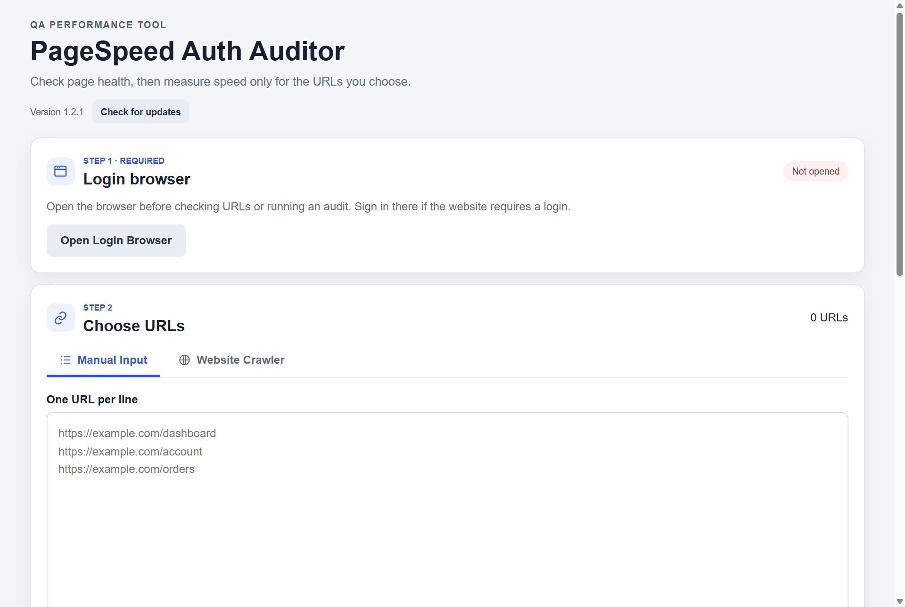
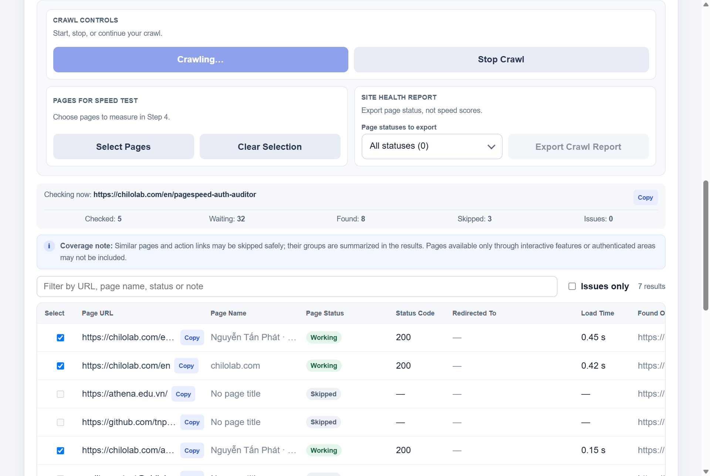
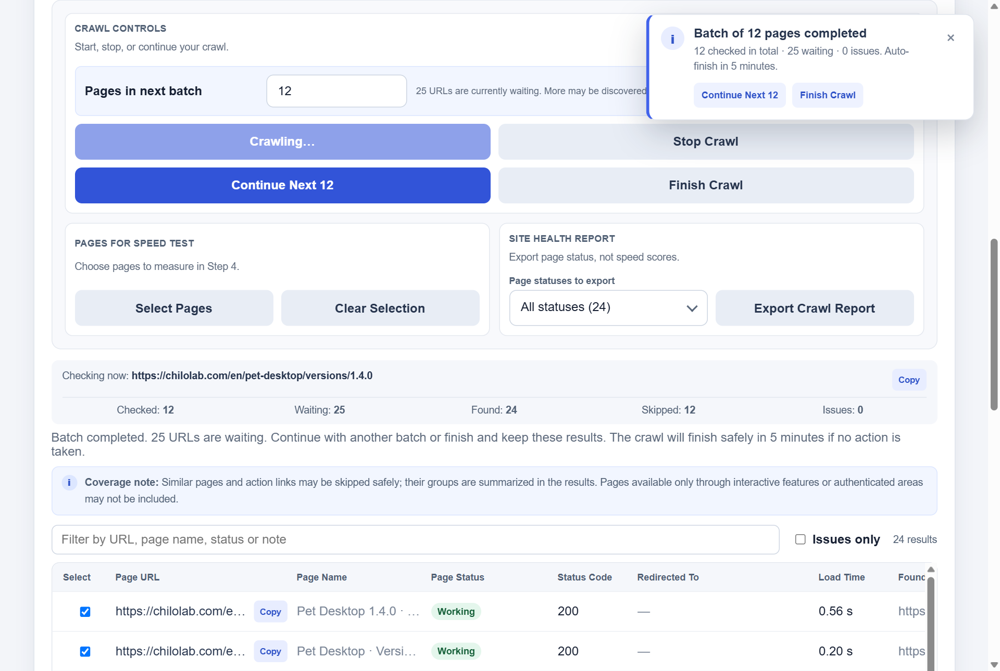
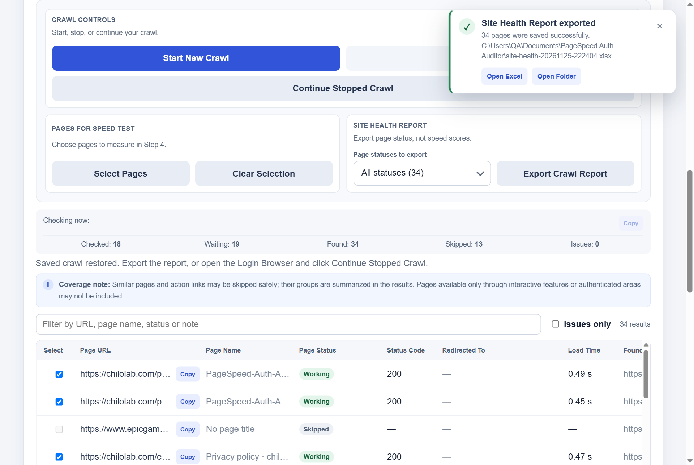
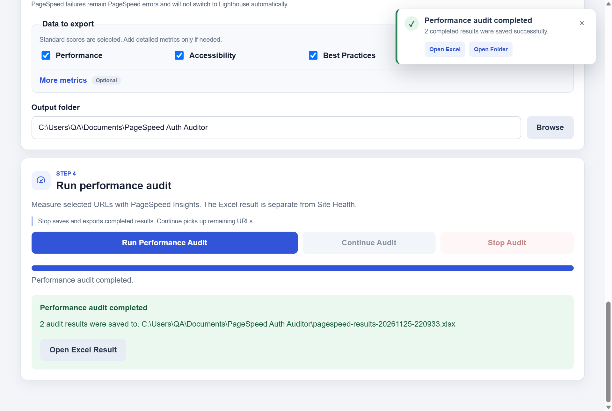
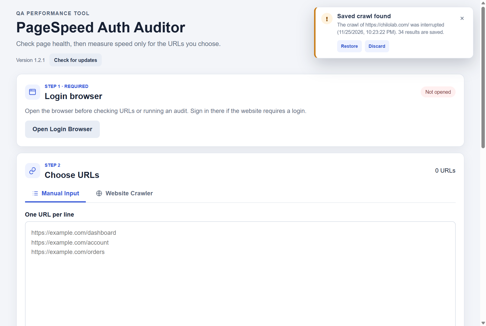

# PageSpeed Auth Auditor

**[chilolab.com/pagespeed-auth-auditor · Giới thiệu & tải về](https://chilolab.com/pagespeed-auth-auditor)**

A Windows QA tool to check website health, crawl every page, and measure PageSpeed / Lighthouse scores, including pages behind a login. Every result is exported to Excel.
Ứng dụng QA website trên Windows: kiểm tra sức khỏe trang, crawl toàn bộ website, đo điểm PageSpeed / Lighthouse kể cả trang cần đăng nhập, và xuất mọi kết quả ra Excel.

Windows 10/11 · x64 · Free · Requires Google Chrome / Cần Google Chrome

## Download / Tải về

| | Link | |
|---|---|---|
| **Installer** (recommended / khuyên dùng) | **[PageSpeed-Auth-Auditor-Setup-win.exe](https://github.com/tnpt003/pagespeed-auth-auditor-releases/releases/latest/download/PageSpeed-Auth-Auditor-Setup-win.exe)** | Updates itself / Tự cập nhật |
| **Portable** | **[PageSpeed-Auth-Auditor-Portable-win.exe](https://github.com/tnpt003/pagespeed-auth-auditor-releases/releases/latest/download/PageSpeed-Auth-Auditor-Portable-win.exe)** | No install / Không cần cài |

1. Download one of the files above and run it. No admin rights needed. / Tải một trong hai file trên rồi chạy, không cần quyền admin.
2. If Windows SmartScreen says "Windows protected your PC": **More info → Run anyway** (the app is not code-signed yet). / Nếu SmartScreen báo "Windows protected your PC": bấm **More info → Run anyway** (ứng dụng chưa được ký số).
3. The installed app checks for updates and asks before restarting. The portable app tells you when a new version is available. / Bản cài đặt tự kiểm tra cập nhật và hỏi trước khi khởi động lại. Bản portable sẽ báo khi có phiên bản mới.

Every version and its notes: [Releases](https://github.com/tnpt003/pagespeed-auth-auditor-releases/releases). / Tất cả phiên bản và ghi chú: trang [Releases](https://github.com/tnpt003/pagespeed-auth-auditor-releases/releases).

## Features / Tính năng

- **Page health check / Kiểm tra sức khỏe trang**: status, HTTP code, redirects, load time for a list of URLs. / Trạng thái, mã HTTP, chuyển hướng, thời gian tải cho danh sách URL.
- **Website crawler**: discovers pages from a start URL and sitemap, skips dangerous links (logout, delete…) and groups similar pages. / Tự khám phá trang từ URL gốc và sitemap, bỏ qua link nguy hiểm (logout, delete…), gom nhóm trang giống nhau.
- **Large crawls stay smooth / Crawl lớn vẫn mượt**: thousands of URLs without freezing; filter by URL, status or issues. / Hàng nghìn URL không bị đứng; lọc theo URL, trạng thái hoặc lỗi.
- **Never lose a crawl / Không mất phiên crawl**: progress is saved continuously. After closing the app, a crash, or a closed browser you can restore, export, or continue. / Tiến trình được lưu liên tục; tắt app, crash hay đóng browser vẫn khôi phục, xuất Excel hoặc crawl tiếp được.
- **Performance audit**: PageSpeed Insights for public pages, Lighthouse with your login session for private pages. Desktop and Mobile. / PageSpeed Insights cho trang công khai, Lighthouse dùng phiên đăng nhập cho trang riêng tư. Desktop và Mobile.
- **Excel reports / Báo cáo Excel**: Site Health and Performance scores with color thresholds. / Site Health và điểm hiệu năng có tô màu theo ngưỡng.

## Gallery / Hình ảnh

| | |
|---|---|
|  |  |
| Main screen / Màn hình chính | Crawl in progress / Đang crawl |
|  |  |
| Continue or finish a batch / Tiếp tục hoặc kết thúc đợt | Export to Excel / Xuất Excel |
|  |  |
| PageSpeed audit / Đo PageSpeed | Restore a saved crawl / Khôi phục phiên crawl |

## Guide / Hướng dẫn

- Tiếng Việt: [images/guide/vi/00-full-guide-vi.png](images/guide/vi/00-full-guide-vi.png) · [từng bước](images/guide/vi)
- English: [images/guide/en/00-full-guide-en.png](images/guide/en/00-full-guide-en.png) · [step by step](images/guide/en)

## Feedback / Góp ý

[Open an issue](https://github.com/tnpt003/pagespeed-auth-auditor-releases/issues) with the app version, Windows version and the steps to the problem. Remove personal information and internal URLs from screenshots and reports.
[Mở issue](https://github.com/tnpt003/pagespeed-auth-auditor-releases/issues), ghi phiên bản app, phiên bản Windows và cách gặp lỗi. Xóa thông tin cá nhân và URL nội bộ khỏi ảnh chụp và báo cáo.

## Note / Lưu ý

This repository holds releases only; the source code is not public. / Repo này chỉ chứa bản phát hành, không có mã nguồn.
